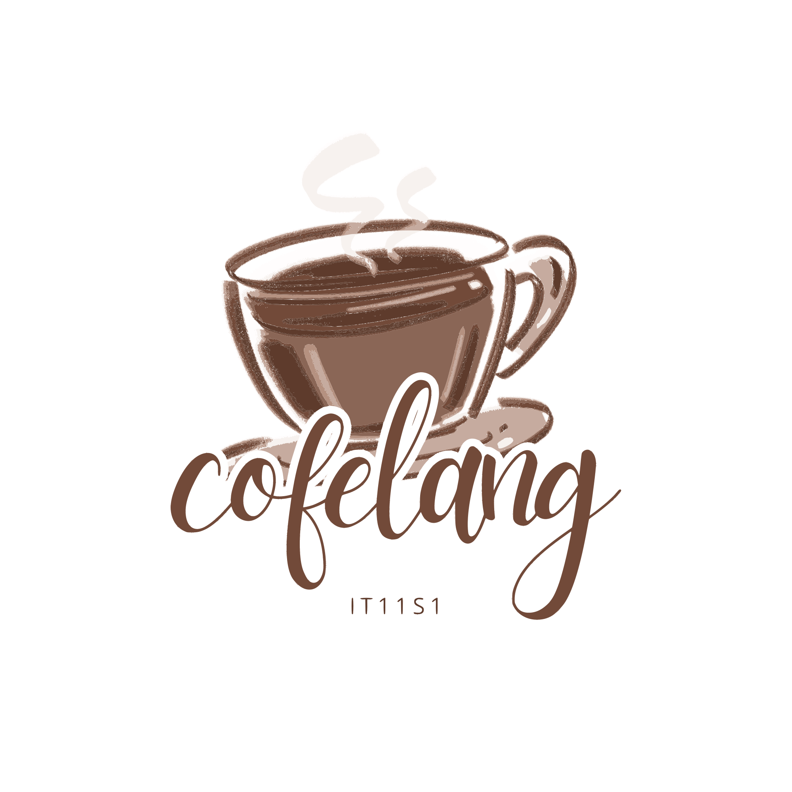

<!-- ═══════════════════════════ HEADER ═══════════════════════════ -->
<div align="center">




### A student-friendly café website, built from scratch with pure HTML5 &amp; CSS3.

*Where great taste meets student-friendly prices. Chill, study, and hang out with friends.*

<br />

[](https://group-5-final-project-website.vercel.app)
[](LICENSE)


<br />

[**Live Demo**](https://group-5-final-project-website.vercel.app) &nbsp;·&nbsp;
[**Features**](#features) &nbsp;·&nbsp;
[**Pages**](#pages) &nbsp;·&nbsp;
[**Getting Started**](#getting-started) &nbsp;·&nbsp;
[**Team**](#meet-the-team)

</div>

<br />

---

## Table of Contents

- [About](#about)
- [Features](#features)
- [Pages](#pages)
- [Menu Highlights](#menu-highlights)
- [Tech Stack](#tech-stack)
- [Project Structure](#project-structure)
- [Getting Started](#getting-started)
- [Design System](#design-system)
- [Meet the Team](#meet-the-team)
- [Contributing](#contributing)
- [License](#license)

---

## About

**CofeLang** is a fictional student café located beside the **Technological Institute of the Philippines (TIP)** along Aurora Blvd, Quezon City. Its mission is simple: give students a warm, welcoming space to enjoy quality drinks and snacks without breaking the bank.

This repository contains the café's official website, designed and developed by **Group 5**, a team of IT students, as an academic project. The entire site is handcrafted using **only HTML5 and CSS3**: no frameworks, no build tools, no dependencies.

> **The idea:** bring CofeLang's menu to the digital world and make it easier for students to browse and order their favorite drinks.

<div align="center">

<!--  Add a screenshot of your homepage here:

-->

</div>

---

## Features

<table>
  <tr>
    <td width="50%" valign="top">

### Warm, Cozy Design
A coffee-inspired palette, elegant **Playfair Display** typography, and soft gradients that make the site feel like the café itself.

  </td>
    <td width="50%" valign="top">

### Fully Responsive
Built with **Flexbox** and **CSS Grid** so every page adapts smoothly from phones to widescreen desktops.

  </td>
  </tr>
  <tr>
    <td width="50%" valign="top">

### Product Showcase
A full menu with categorized product cards, images, descriptions, and student-friendly prices in ₱.

  </td>
    <td width="50%" valign="top">

### Cart &amp; Checkout Flow
A cart page with form elements and an order summary table, plus a dedicated checkout success page.

  </td>
  </tr>
  <tr>
    <td width="50%" valign="top">

### Find Us on the Map
An embedded Google Map that points visitors straight to the café near TIP, Aurora Blvd.

  </td>
    <td width="50%" valign="top">

### Accessible &amp; Semantic
Semantic HTML5 structure, descriptive `alt` text, and proper meta tags for accessibility and SEO basics.

  </td>
  </tr>
</table>

---

## Pages

| Page | File | What's inside |
| :--- | :--- | :--- |
| **Home** | [`index.html`](index.html) | Hero banner, why CofeLang, what we offer, best sellers, and the location map |
| **About Us** | [`about.html`](about.html) | The CofeLang story and mission |
| **Products** | [`products.html`](products.html) | The complete menu, organized by category |
| **Cart** | [`cart.html`](cart.html) | Order form and order summary table |
| **Checkout Success** | [`checkout-success.html`](checkout-success.html) | Order confirmation screen |
| **Developers** | [`developers.html`](developers.html) | Meet the team behind the site |

---

## Menu Highlights

A taste of our student-favorite best sellers:

| Category | Item | Price |
| :--- | :--- | ---: |
| Frappe | Caramel Espresso Frappe | ₱160 |
| Milk Tea | Matcha Milk Tea | ₱110 / ₱130 |
| Iced Coffee | Dark Mocha | ₱140 / ₱150 |
| Pizza | Pepperoni Pizza (6.5" solo) | ₱125 |
| Pasta | Carbonara | ₱125 |
| Pastries | Blueberry Cheesecake | ₱160 / slice |

*Explore the full menu on the [Products page](https://group-5-final-project-website.vercel.app/products.html).*

---

## Tech Stack

<div align="center">

| Technology | Purpose |
| :---: | :--- |
|  | Semantic structure, forms, and embedded content |
|  | Flexbox, Grid, transitions, gradients, and responsive layout |
|  | Playfair Display typography |
|  | Embedded location map |
|  | Code editor |
|  | Hosting and deployment |

</div>

---

## Project Structure

```text
CofeLang/
├── assets/                 # Images, icons, product photos, developer photos
├── index.html              # Home
├── about.html              # About Us
├── products.html           # Menu / Products
├── cart.html               # Cart & order form
├── checkout-success.html   # Order confirmation
├── developers.html         # Meet the team
├── styles.css              # Shared external stylesheet
├── logo.svg                # CofeLang logo
├── LICENSE                 # GPL-3.0
└── README.md
```

---

## Getting Started

No installation, no build step. Just clone and open.

### 1. Clone the repository

```bash
git clone https://github.com/KimDelmoro2008/CofeLang.git
cd CofeLang
```

### 2. Run it

**Option A: open directly**

Double-click `index.html`, or open it in your browser.

**Option B: use a local server** (recommended)

```bash
# Python
python -m http.server 8000

# or Node.js
npx serve .
```

Then visit **http://localhost:8000** 

### 3. Deploy

The project is a static site, so it deploys anywhere (Vercel, Netlify, GitHub Pages). It is currently hosted on **Vercel**.

---

## Design System

CofeLang uses a warm, coffee-inspired palette.

| Swatch | Hex | Usage |
| :---: | :---: | :--- |
|  | `#4E342E` | Headings, primary text, deep espresso |
|  | `#6D4C41` | Secondary text |
|  | `#8D6E63` | Muted text and accents |
|  | `#FFCC80` | Tags and highlights |
|  | `#D7CCC8` | Soft backgrounds and placeholders |

**Typography:** [Playfair Display](https://fonts.google.com/specimen/Playfair+Display) (400 · 600 · 700)

---

## Meet the Team

We are IT students and co-founders of CofeLang, and **Group 5** built every page from scratch.

| Member | Role | Contributions |
| :--- | :--- | :--- |
| **Kim Delmoro** ([@KimDelmoro2008](https://github.com/KimDelmoro2008)) | Founder &amp; Lead Developer | Site structure, semantic HTML5 layout, team coordination, Home &amp; About pages |
| **Raniel Magpatoc** | Front-End Developer &amp; Co-Founder | CSS styling, responsive design, Products &amp; Cart pages |
| **Wadanhyll Shaun Tolentino** | Web Designer &amp; Co-Founder | Visual design, color scheme, Developers page |
| **John Dexter Miraflor** | Back-End Developer | Cart &amp; checkout pages, form validation structure, order summary table |
| **Madelaine Lano** | UI &amp; Logo Designer | Visual design, color scheme, logo creation |
| **Cleo Ken Miguel Ramos** | Content Strategist | Product descriptions, About page narrative, meta descriptions |
| **Justin Kobe Litonjua** | Web Tester | Cross-browser and cross-device testing, accessibility checks |
| **Lance Jairus Jamito** | Documentation Lead | Project documentation, technical report, milestone coordination |

---

## Contributing

Contributions, issues, and feature ideas are welcome!

1. **Fork** the project
2. **Create** your feature branch: `git checkout -b feature/amazing-feature`
3. **Commit** your changes: `git commit -m "Add amazing feature"`
4. **Push** to the branch: `git push origin feature/amazing-feature`
5. **Open** a Pull Request

Found a bug? [Open an issue](https://github.com/KimDelmoro2008/CofeLang/issues).

---

## License

Distributed under the **GNU General Public License v3.0**. See [`LICENSE`](LICENSE) for details.

---

<div align="center">

### Made with love, caffeine, and a lot of `<div>`s by **Group 5**

If you like this project, consider giving it a star

<br />


</div>
